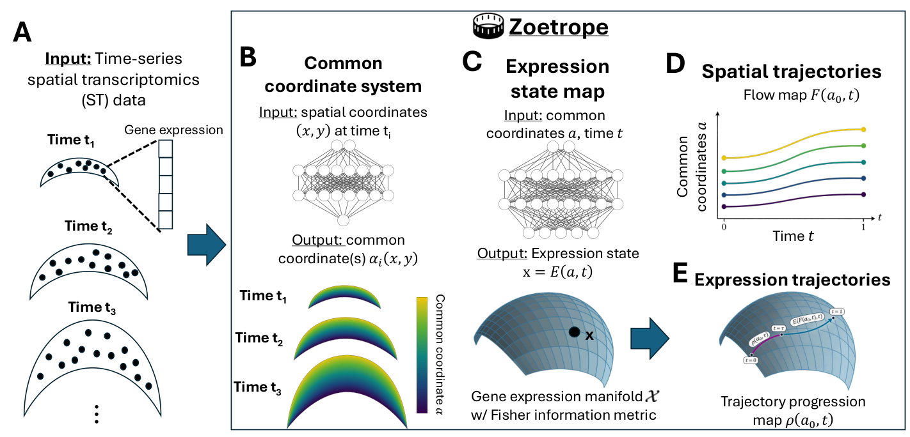

# Zoetrope


**Spatial and gene expression trajectory inference from time-series spatial transcriptomics data**

Zoetrope is a geometric deep learning framework for reconstructing spatial and gene expression trajectories from time-series spatial transcriptomics (ST) data.

Zoetrope learns a common anatomical coordinate system across tissue sections and models gene expression continuously over anatomical position and developmental time. Using the Fisher information metric, it identifies a spatial velocity field by minimizing residual gene expression change along cellular trajectories.

**Paper:** James O'Quinn and Uthsav Chitra, *Zoetrope efficiently reconstructs spatial trajectories from time-series spatial transcriptomics data*. Submitted to RECOMB 2027.

## Overview



Time-series spatial transcriptomics measures spatial gene expression in different tissue sections collected at successive developmental stages. Because these measurements are destructive, individual cells cannot be directly tracked over time.

Zoetrope addresses two central challenges:

1. **Anatomical alignment:** Tissue sections collected at different developmental stages may differ substantially in geometry, making their physical coordinates incomparable.
2. **Trajectory identification:** Observed gene expression changes may arise from cellular movement, intrinsic molecular changes, or both.

Zoetrope combines anatomical coordinate learning with a geometric principle for disentangling these processes.

### Key features

- **Shared anatomical coordinates:** Learns a common coordinate system across tissue sections, accommodating nonrigid geometric differences.
- **Continuous expression modeling:** Learns a spatiotemporal gene expression field using neural networks and a Poisson observation model.
- **Geometric trajectory inference:** Derives spatial velocity using the Fisher information metric without training an independent velocity network.
- **Developmental progression:** Estimates cumulative molecular change along inferred trajectories.
- **Multiple tissue sections:** Supports multiple sections measured at the same developmental timepoint.
- **Scalability:** Designed to analyze spatial transcriptomics datasets containing millions of cells.

## How Zoetrope works

Zoetrope consists of three main computational steps.

### 1. Common anatomical coordinate learning

For each tissue section, Zoetrope learns a map

$$\[
\alpha_i:T_i\rightarrow\mathbb{R}^D
\]$$

that maps observed spatial positions to a common anatomical coordinate system.

The current implementation uses a one-dimensional common coordinate (\(D=1\)).

### 2. Spatiotemporal gene expression modeling

Zoetrope learns an expression state map

$$\[
E(a,t)
\]$$

representing expected gene expression at anatomical coordinate \(a\) and developmental time \(t\).

Gene expression is modeled using a neural field with a library-size-adjusted Poisson likelihood.

### 3. Spatial trajectory inference

For a fixed learned expression field, Zoetrope derives the spatial velocity field by minimizing residual expression change under the Fisher information metric:

$$\[
V(a,t)=
\underset{v}{\mathrm{argmin}}
\left\|
\partial_t E(a,t)+D_aE(a,t)v
\right\|_h^2.
\]$$

For a one-dimensional anatomical coordinate, this gives

$$\[
V(a,t)=-
\frac{
\langle\partial_t E(a,t),\partial_a E(a,t)\rangle_h
}{
\|\partial_a E(a,t)\|_h^2
}.
\]$$

Spatial trajectories are obtained by integrating the velocity field numerically using a fourth-order Runge-Kutta method.

Zoetrope also computes a developmental progression measure from cumulative Fisher-geometric expression change along inferred trajectories.

## Installation

Zoetrope requires Python 3.10 or newer and PyTorch.

Clone the repository:

```bash
git clone https://github.com/chitra-lab/Zoetrope.git
cd Zoetrope
```

Create and activate a Python environment:

```bash
python -m venv .venv
source .venv/bin/activate
```

Install Zoetrope:

```bash
python -m pip install --upgrade pip
python -m pip install -e .
```

For the PFC dataset loader, Jupyter notebooks, and testing dependencies:

```bash
python -m pip install -e ".[qian,notebooks,test]"
```

The current Python package is named `flow_stp`, reflecting the original development name of Zoetrope.

### Verify installation

```bash
python -c "import flow_stp; print('Zoetrope imported successfully')"
python -m pytest -q tests/test_stage2_dynamics.py
```

GPU acceleration is recommended for large spatial transcriptomics datasets.

## Getting started

### Input data

Zoetrope takes time-series spatial transcriptomics measurements consisting of:

- Gene expression counts for cells in each tissue section.
- Two-dimensional spatial coordinates of those cells.
- Developmental time associated with each section.
- Tissue identifiers and a common gene panel.

The model estimates the shared anatomical coordinate maps and spatiotemporal expression field jointly.

### Python API

The selected Stage 1 implementation can be imported using:

```python
from flow_stp.stage1 import (
    Stage1ARunConfig,
    run_stage1a,
)

from flow_stp.stage2 import (
    estimate_local_dynamics,
    integrate_flow_rk4,
)
```

Given prepared input arrays and tissue metadata:

```python
result = run_stage1a(
    counts_by_slice=counts_by_slice,
    spatial_by_slice=spatial_by_slice,
    panel_df=panel_df,
    gene_names=gene_names,
    obs_df=obs_df,
    config=Stage1ARunConfig(
        output_dir="experiments/example"
    ),
)
```

The fitted model provides a Fisher-flat representation of the expression field:

```python
field = result.model.fisher_flat
```

Given PyTorch tensors `z`, `t`, and `anchors` in the fitted anatomical coordinate system:

```python
local = estimate_local_dynamics(
    field,
    z,
    t,
)

trajectory = integrate_flow_rk4(
    field,
    anchors,
    t0=0.0,
    t1=1.0,
)
```

No independent spatial velocity network or additional Stage 2 training is required.

## Tutorials

### Human prefrontal cortex MERFISH dataset

The repository includes a general workflow for applying Zoetrope to the developing human prefrontal cortex MERFISH dataset:

[Qian PFC workflow notebook](flow_stp_full_stage1_qian_pfc_workflow.ipynb)

This notebook demonstrates:

1. Loading the MERFISH expression and spatial data.
2. Fitting the shared anatomical coordinate and expression field.
3. Deriving the Fisher-projected velocity.
4. Integrating inferred spatial trajectories.

**Note:** The notebook uses the current Zoetrope implementation, but its default tissue selection includes GW34. It is a general application example rather than an exact reproduction of the nine-tissue analysis or the GW20 holdout experiment in the RECOMB submission.

The Qian MERFISH dataset must be obtained separately. Update the notebook's `DATA_ROOT` and output directory before running it.

### Synthetic examples

Additional simulation and evaluation tools are available in:

- [`src/flow_stp/simulations/`](src/flow_stp/simulations/)
- [`notebooks/`](notebooks/)
- [`benchmarks/`](benchmarks/)

These include examples for evaluating anatomical coordinates, Fisher-projected dynamics, and tissue-space displacement.

## Reproducing the paper

The RECOMB 2027 manuscript evaluates Zoetrope on:

1. A synthetic time-series atlas of developing crescent-shaped tissues.
2. A human prefrontal cortex MERFISH atlas.

The experiments evaluate anatomical coordinate recovery, spatial trajectory reconstruction, held-out gene expression prediction, developmental progression, and computational efficiency.


## Repository structure

```text
Zoetrope/
├── src/
│   └── flow_stp/
│       ├── stage1/          # Anatomical coordinates and expression field
│       ├── stage2/          # Fisher velocity and trajectory integration
│       ├── data/            # Dataset loading utilities
│       └── simulations/     # Synthetic data generators
├── notebooks/              # Example and evaluation notebooks
├── benchmarks/             # Benchmark utilities
├── docs/                   # Technical documentation
├── tests/                  # Unit and regression tests
├── results/                # Selected benchmark visualizations
├── pyproject.toml
└── README.md
```

Historical implementations are retained separately from the selected model.

## Model implementation details

The current implementation uses:

| Component | Implementation |
|---|---|
| Anatomical coordinate network | MLP, two hidden layers of width 64, tanh |
| Gene expression network | MLP, two hidden layers of width 128, GELU |
| Expression likelihood | Poisson with library-size offsets |
| Optimizer | AdamW |
| Learning rate | 0.002 |
| Weight decay | 0.00001 |
| Training | 1,500 minibatch optimization updates |
| Batch size | Up to 1,024 cells per tissue per update |
| Spatial dynamics | Fisher-projected velocity |
| Numerical integration | Fourth-order Runge-Kutta |

When multiple tissue sections are observed at the same developmental time, the coordinate model can incorporate tissue identity while maintaining a shared anatomical representation.

The current implementation uses a pooled global normalization of the inferred anatomical coordinate.


