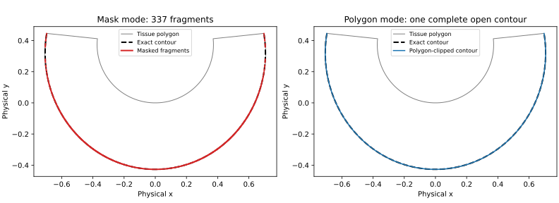
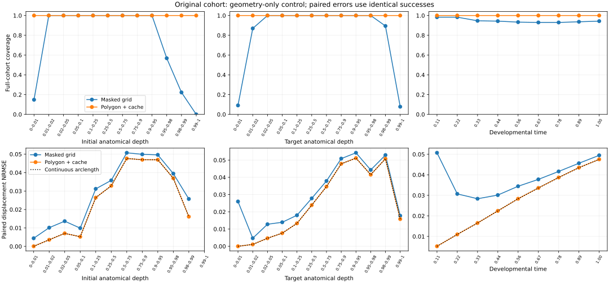
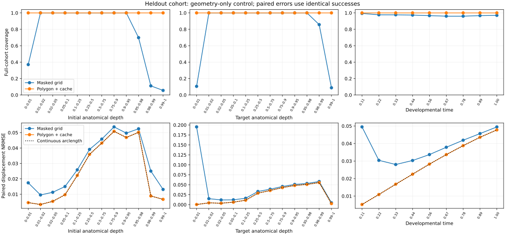

# Boundary-aware normalized-arclength reconstruction

## Outcome

Clip full-grid anatomical contours to an explicitly supplied tissue polygon and use a bounded exact-depth cache. This preserves the canonical normalized-arclength correspondence. Stage 1, Fisher velocity, Stage 2 RK4, and the biological generators are unchanged.

**All results below are geometry-only controls using oracle anatomical fields, oracle tissue geometry, and true anatomical flow. They are not learned-model performance.**

## Baseline reproduction and held-out evaluation

Current upstream baseline: `5cc8038c6025991bb5f8e5d90c9a4ccd17e0eb46` (merged PR #39). The earlier validation bundle was recovered. Its 300 initial cells, source IDs, depths, transverse positions and frozen geometry are sufficient to reconstruct the same cohort. Baseline coverage and both NRMSE values match the archived result. The large D1 archive itself was not downloaded.

Each cohort contains 300 independent initial cells with nine repeated target times. Paired error comparisons use exactly the same successful endpoints; coverage always uses all 2,700 attempts.

| Cohort | Paired endpoints | Baseline NRMSE | Polygon NRMSE | Continuous arclength | Baseline coverage | Polygon coverage |
|---|---:|---:|---:|---:|---:|---:|
| original | 2,559 | 0.04392577 | 0.04099687 | 0.04099718 | 94.78% | 100% |
| heldout | 2,623 | 0.04391459 | 0.04111691 | 0.04111721 | 97.15% | 100% |

On the complete 2,700-endpoint cohorts, polygon NRMSE is 0.04119052 (original) and 0.04110086 (held-out). The corresponding full-cohort continuous controls are 0.04119082 and 0.04110116.

| Cohort/method | Endpoint RMSE | Oracle contour RMSE | Numerical RMSE versus continuous endpoint | Prediction + oracle time (s) | Field build (s) | Total (s) | Peak process RSS (MiB) |
|---|---:|---:|---:|---:|---:|---:|---:|
| original/baseline | 0.0068068264 | 4.01936e-05 | 0.00088500956 | 31.48 | 32.01 | 66.61 | 424.3 |
| original/polygon_cached | 0.0065557606 | 9.9507087e-07 | 1.0052523e-06 | 8.03 | 22.71 | 31.53 | 461.2 |
| heldout/baseline | 0.0067148198 | 5.2268313e-05 | 0.00085054573 | 21.30 | 23.44 | 45.54 | 442.9 |
| heldout/polygon_cached | 0.0063716075 | 1.0017037e-06 | 1.0018805e-06 | 9.58 | 25.69 | 36.26 | 464.8 |

The RMSE table uses each method's successful subset; use the preceding paired table for causal accuracy comparisons. RMSE is the root mean squared Euclidean endpoint error in simulator physical units, and NRMSE divides summed squared error by summed squared true source-to-target displacement. These are endpoint errors, equivalently displacement errors because the source is identical.

Final cohort runs were sequential in separate processes. Runtime includes oracle evaluation; total time also includes inverse-chart grid construction and continuous-control evaluation, but excludes Python import/startup. RSS includes imports (including Torch) and control arrays, so it is not standalone contour-cache memory. Shared-machine timing is approximate. Bounded caching trades modest additional memory for fewer repeated extractions. Field-build timing variation is unrelated to caching.

## Bootstrap intervals

3,000 bootstrap resamples over initial cells (seed 732), retaining all nine time measurements. Intervals are percentile 95% intervals. No individual endpoints are treated as independent biological replicates.

- original: paired polygon-minus-baseline NRMSE difference interval [-0.00312152, -0.00274054].
  - baseline: successful-subset NRMSE interval [0.04055420591931228, 0.047683574532125066]; empirical coverage interval [0.9248148148148149, 0.9692592592592593].
  - polygon_cached: successful-subset NRMSE interval [0.03791964234425137, 0.04465949355973398]; empirical coverage interval [1.0, 1.0].
- heldout: paired polygon-minus-baseline NRMSE difference interval [-0.00296867, -0.00262533].
  - baseline: successful-subset NRMSE interval [0.040470444701880874, 0.04762426883074654]; empirical coverage interval [0.9525833333333333, 0.987037037037037].
  - polygon_cached: successful-subset NRMSE interval [0.03778013206473624, 0.04462753081247546]; empirical coverage interval [1.0, 1.0].

The [1,1] coverage intervals reflect no failures in these finite cohorts, not a population guarantee.

## Root causes and error separation

**A. Boundary extraction.** With `corner_mask=False`, any grid square touching an outside mask vertex is excluded. Near a curved boundary, the remaining thin strip alternates between covered and removed squares, yielding many short contour fragments or no contour. Original failures: 123 fragmented and 18 absent contours. Held-out failures: 77 fragmented contours. Polygon clipping gives zero failures in both cohorts. A valid unique masked contour can also end prematurely, changing its total length and every normalized-arclength endpoint.

**B. Numerical geometry.** Define numerical error directly as the vector distance from the numerical canonical endpoint to the high-resolution continuous canonical endpoint. Do not subtract their squared errors against truth: those errors contain cross terms. On the original successful subset, masked numerical RMSE is 0.000885; polygon full-cohort numerical RMSE is approximately 0.000001. The remaining error includes grid interpolation, contour chord approximation, and polygon discretization. Refining the existing bilinear field modestly reduces this residual; it does not supply better anatomical values.

**C. Transverse correspondence.** In the frozen generator, material transverse position is preserved, but unequal tangential stretching changes the normalized arclength density. Constant normalized arclength therefore differs from constant material position even on exact contours. Continuous arclength NRMSE is approximately 0.041. This is an assumption-limited floor for the present canonical rule. Numerical errors can partially cancel correspondence errors: this occurred on the development cohort.

Writing $e=e_{\mathrm{correspondence}}+e_{\mathrm{numerical}}$ gives $\|e\|^2=\|e_{\mathrm{correspondence}}\|^2+\|e_{\mathrm{numerical}}\|^2+2\langle e_{\mathrm{correspondence}},e_{\mathrm{numerical}}\rangle$. The cross term explains why more faithful geometry need not lower endpoint error in every sample.

**D. Anatomical coordinate error.** Not measured here: no frozen learned coordinate checkpoint or inferred Stage 2 endpoints were supplied. In learned experiments, compare learned and known contours at fixed target depth while holding the reconstruction convention fixed, then examine source coordinate/projection error separately. Oracle nearest-contour error measures distance to the particular supplied contour and mixes anatomical and numerical contour errors unless the numerical contribution is independently bounded. Polygon clipping cannot correct a biased learned axis or incorrect target depth.



## Controlled development tournament

Development seed 20261013, 100 independent initial cells, 900 endpoints, 320 × 280 grid. Original and held-out evaluation results were not used to select or tune the method. Default cache capacity was fixed at 512 (exact depth keys; no rounding).

| Variant | Coverage | NRMSE on own successes | NRMSE on common 846 endpoints | Numerical NRMSE on common endpoints | Oracle NRMSE on own successes | Prediction time (s) | RSS (MiB) |
|---|---:|---:|---:|---:|---:|---:|---:|
| baseline | 94.00% | 0.03202452 | 0.03202452 | 0.004999172 | 1.3623931e-05 | 4.92 | 349.3 |
| corner | 95.44% | 0.03098349 | 0.03114304 | 0.0056249204 | 1.3624315e-05 | 4.22 | 350.4 |
| polygon | 100.00% | 0.03272975 | 0.03425004 | 1.4124032e-05 | 1.286863e-05 | 4.31 | 356.8 |
| polygon_refined | 100.00% | 0.03272976 | 0.03425005 | 1.2802047e-05 | 1.1760102e-05 | 11.08 | 393.7 |
| polygon_cached | 100.00% | 0.03272975 | 0.03425004 | 1.4124032e-05 | 1.286863e-05 | 2.01 | 362.3 |

**The development paired displacement score gets worse with polygon clipping:** 0.03202 → 0.03425. Its numerical geometry is nevertheless much more accurate and its coverage is complete. Selection favored faithful canonical geometry and coverage, not numerical distortion that happened to cancel the transverse-assumption error. Both evaluation cohorts subsequently show a paired displacement improvement.

Corner masking recovered some endpoints but increased numerical correspondence error and retained failures. Twofold bilinear subdivision reduced an already tiny residual by about 9% while more than doubling extraction/evaluation time relative to plain polygon clipping. Cached and uncached polygon predictions are numerically identical. Development timing runs overlapped and are exploratory; only final sequential cohort timing should be used for throughput claims.

Adaptive boundary refinement, continuous-field root projection, and alternate material correspondence were not implemented: clipping removes the dominant numerical failure, remaining numerical error is negligible relative to correspondence error, and a material convention would change the stated method. These remain future options rather than tested improvements.

## Conditional results

Plots report full-cohort coverage and paired displacement error by source depth, target depth, and developmental time. Error curves are absent where no paired successes exist. Exact bin counts are in the accompanying CSV files.





## Reproduction and provenance

- Install `pip install -e '.[geometry,test,notebooks]'` in a Python ≥3.10 environment.
- Run commands from the repository root; no GPU, fitted model, or large D1 archive is required.
- The downloadable validation package includes `benchmarks/arclength/original_cohort.csv`, containing only the recovered initial cohort, not future destinations. Its individual rows are not published to GitHub; pass its local path with `--source-cohort` to reproduce the original-cohort run. Original source selection seed was 142.
- Frozen `geometry.py` preserves the archived Regime B/D1 geometry formulas and true anatomical flow. These differ from the currently packaged `benchmark_dgp._warp_tissue`; no packaged biological generator was edited.
- Held-out seed 20261014 generates 300 new uniformly sampled source depths/transverse positions. All variants use the same cells for each cohort.
- Times: 1/9 through 1; source time 0. Fine grid: 500 × 420; margin 0.018 physical units; polygon samples: 1,201 points per curved side, 129 per straight side.
- Inverse chart: analytic-Jacobian Newton solve, 22 iterations, nearest-center initialization. Per-grid residuals are saved.
- Anatomical gradient threshold 1e-6; minimum tangent/rotated-gradient cosine 0.5; source projection distance at most two maximum grid diagonals.
- Synthetic pose translations are removed as in the archived oracle-geometry control. No true destination is passed to canonical reconstruction. The oracle comparator runs only after prediction.
- Continuous control integrates exact contour speed on 8,193 samples. See `ideal_convergence.json` for an independent 32,769-sample check.

```bash
python benchmarks/arclength/run.py --cohort original --variant baseline
python benchmarks/arclength/run.py --cohort original --variant polygon_cached
python benchmarks/arclength/run.py --cohort heldout --variant baseline
python benchmarks/arclength/run.py --cohort heldout --variant polygon_cached
for variant in baseline corner polygon polygon_refined polygon_cached
do
  python benchmarks/arclength/run.py --cohort development --variant "$variant" --nx 320 --ny 280
done
python benchmarks/arclength/analyze.py
python -m pytest -q
```

Per-endpoint results, grid diagnostics, summaries, conditional counts, bootstrap intervals and SVG/PNG plots are saved under `results/arclength/`. In the downloadable validation package, bulk endpoint CSVs are gzip-compressed; analysis accepts both compressed and uncompressed files.

## Regression tests and Methods recommendation

Full repository suite: **66 passed**. Tests cover sub-grid boundary levels and exact linear boundaries; invalid or truncated polygons; true disconnected contours; closed loops; gradient degeneracy; anatomical-sign orientation reversal; cache bounds and read-only arrays; and unchanged canonical predictions after modifying true destinations (including polygon mode). The existing mask APIs remain compatible.

For RECOMB Methods, use **oriented normalized-arclength transfer on anatomical level sets clipped to observed tissue polygons**, with bounded exact-depth caching described as an implementation detail. Explicitly retain the transverse correspondence assumption and distinguish imputed tissue endpoints from identified material lineages. Quote these results as geometry-only numerical controls; learned-model validation remains necessary.
